**Live prototype:** https://airbnb-trip-planner-dusky.vercel.app

# Kyoto trip planner: three-card stage

A chat prototype inside the Airbnb mobile app. You ask for a weekend trip, and the chat replies with **three cards**: a stay, an experience and a meal. A trip summary under the cards checks the total against your budget.

This is a portfolio prototype. It uses Airbnb's name, logo and colours for demonstration only and isn't affiliated with Airbnb.

## Run it locally

Requires Node 20+. Run `npm install && npm run dev`, then open http://localhost:3000.

To see the error state, add `?fail=once` to the URL. See [Broken state](#broken-state).

## Desktop version

On a screen 1024px wide or more, the chat opens as a 520px side panel over a mock of the Airbnb website home page, instead of a sheet over the mobile app. The page behind dims, and the thread, cards, thinking dots, skeletons and error state are the same as on the phone.

- **Open:** the panel is open when the page loads. **Close** (✕, or the Esc key) slides it away, and the red **Plan a trip** button at the bottom right of the page brings it back with the thread intact.
- **Phones and tablets:** below 1024px the layout is unchanged. Phones get the full-screen sheet over the mobile home screen, and tablets get the phone frame.

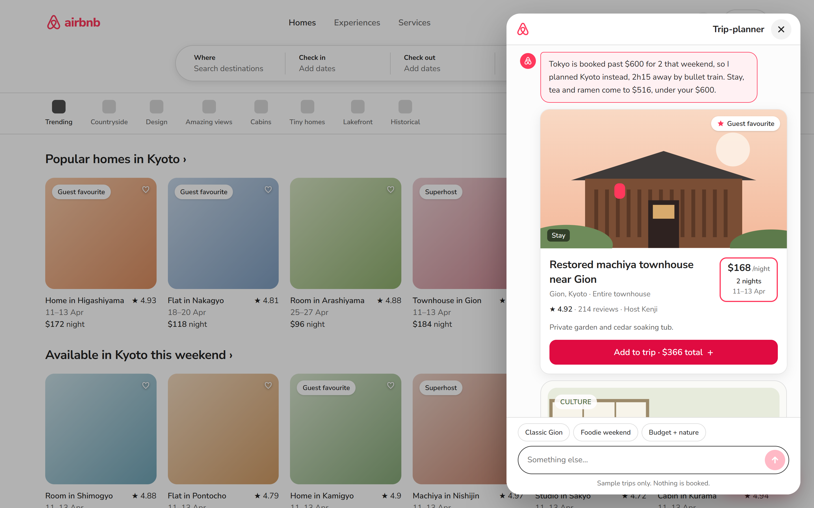

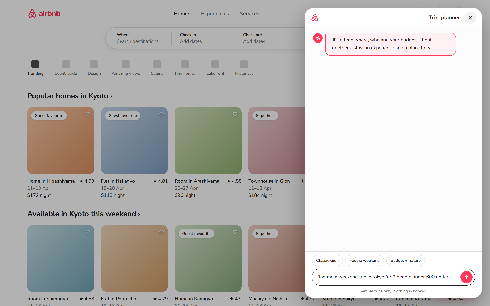
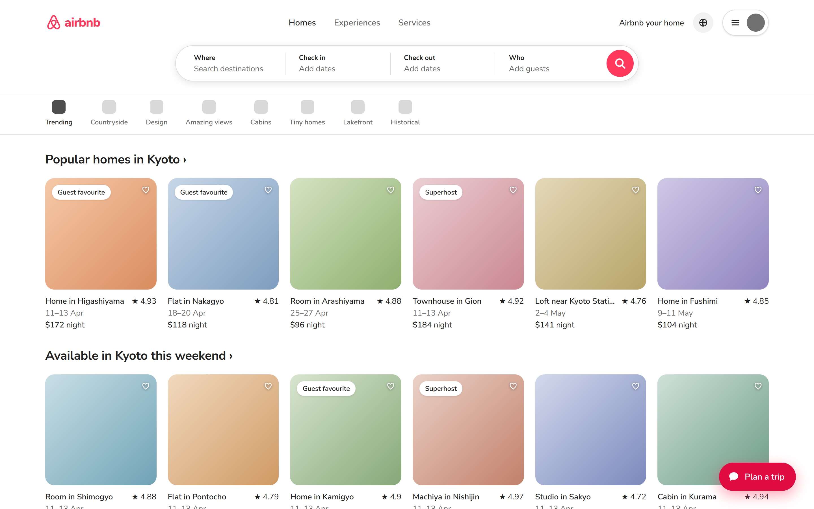

## Card fields that use a filler line

The content comes from the *Kyoto Weekend Prototype Content Pack* workbook. Where the workbook has no value for a field, the card shows a filler line, marked `// filler` in `src/lib/mockReply.ts`.

| Card | Field with filler | What it shows |
|---|---|---|
| Stay | Popularity badge | "Guest favourite", "Rare find", "Great value" |
| Stay | Photo | A drawn illustration (the workbook has no cleared photos) |
| Experience | One-line description | e.g. "Whisk your own matcha with Mei, slowly, the old way." |
| Experience | **Know more** text | The longer description behind the button |
| Experience | Distance from the stay | e.g. "10 min away" |
| Experience | Photo | A drawn illustration |
| Food | Rating and review count | e.g. ★ 4.7 · 320 reviews |
| Food | Menu (dishes, prices, portions, veg / non-veg) | e.g. Shio ramen $12 · 1 bowl |
| Food | Booking note (Sagano Yudofu-tei only) | "Walk-ins welcome at lunch" |
| Food | Photo | A drawn illustration |

Every other field (names, prices, dates, hosts, stay ratings, meeting points, walking times, availability) comes from the workbook.

## Three scenarios

The request decides which plan you get. The search is faked in `src/lib/planner.ts`: it reads the budget and theme words from your message. The chips above the message box send each sample request.

| Scenario | Try asking | Total for 2 |
|---|---|---|
| Classic Gion | "find me a weekend trip in tokyo for 2 people under 600 dollars" | $516 / $600 |
| Foodie weekend | "a foodie weekend in Kyoto for 2 people under $600" | $546 / $600 |
| Budget + nature | "Kyoto on a budget for 2, under $400, with some nature" | $279 / $400 (the sold-out walk is left out) |

Screenshots of each thread: [Classic Gion](docs/thread-1-classic-gion.png) · [Foodie weekend](docs/thread-2-foodie.png) · [Budget + nature](docs/thread-3-budget-nature.png).

## Broken state

**To fire it:** add `?fail=once` to the URL (https://airbnb-trip-planner-dusky.vercel.app/?fail=once) and send any trip request.

The first reply is a broken mock response the app can't turn into cards. The thread never goes blank: an error bubble appears with **Try again**, and tapping it brings the cards back. Only the first request fails.

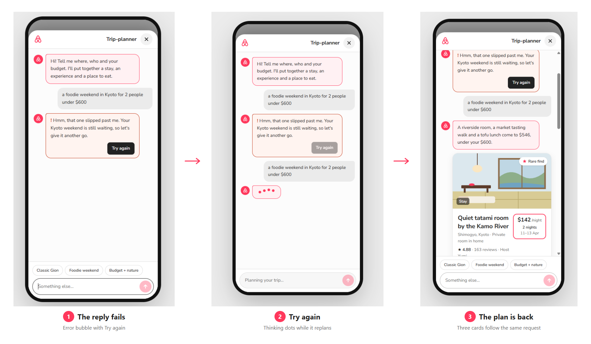

### What happens

| Step | What you see |
|---|---|
| 1 | You send a request. The input locks and the thinking dots show. |
| 2 | Card-shaped skeletons show while the reply "loads". |
| 3 | The reply is checked, fails, and an error bubble replaces the skeletons: *"Hmm, that one slipped past me. Your Kyoto weekend is still waiting, so let's give it another go."* |
| 4 | **Try again** reruns the same request with real data: thinking dots, skeletons, then the three cards and the trip summary. |

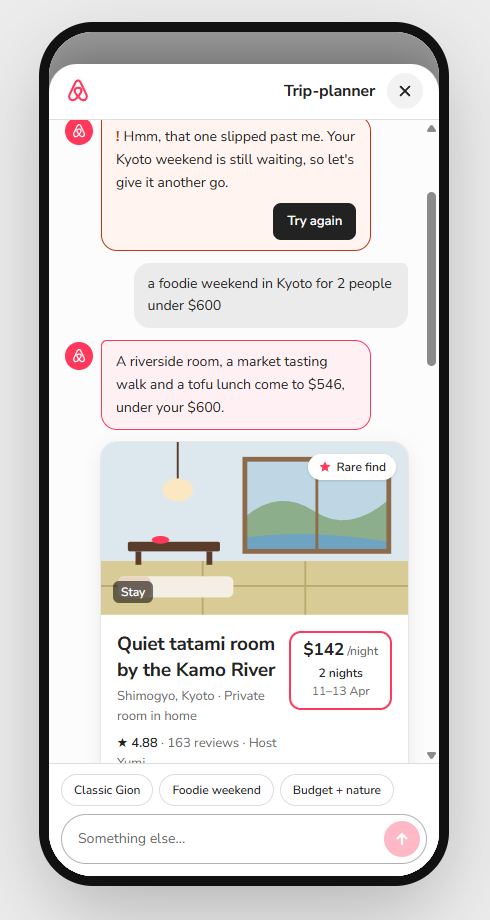

### What is broken in the data

The broken reply is in `src/lib/brokenReply.ts`. It looks like a real reply but can't become the three cards:

| Card | Problem |
|---|---|
| Stay | No name, and the total is the text "three hundred", not a number |
| Experience | Labelled `activity`, which isn't one of the three card types |
| Food | Missing, so only two cards come back |

Every reply, real or broken, goes through `parseReply` in `src/lib/parseReply.ts` before it becomes cards. It needs three cards in the order stay → experience → food, each with its required fields. The broken reply fails that check, and the reason is logged to the browser console (`reply rejected: expected 3 cards, got 2`).

## Moderated session checklist

The rules below come from *Moderated Session Prototype Requirements: Trip-Planner Chat*, the note that says what a prototype link must meet before UX Research opens it with a guest. Each line was checked against the live link in a fresh private window with nothing logged in.

**Last tested:** Sunday 15 November 2026.

**Session setups**
- [x] **Phone:** tested on a real phone, no errors (hand test by Arpan). The setup the note asks for: iPhone 14, Safari, about 390px wide, private window, not logged in to Airbnb or Vercel.
- [x] **Laptop:** 13-inch MacBook Air, Chrome, about 1440px wide, incognito window, not logged in to Airbnb or Vercel. The chat opens as a side panel over the website (see [Desktop version](#desktop-version)).

> The phone screenshots and the automated checks (thinking state first, 0 blank samples, no sideways scrolling) come from a fresh private Chrome window at 390px with an iPhone user agent. They show the layout and the flow, but they are not Safari itself.

**What the prototype must do**
- [x] **3 of 3 cards:** one typed trip request shows a thinking state first, then a stay card, an Experience card and a food card
- [x] **Clearly different cards:** each card is its own component with its own layout, not one layout with the text swapped
- [x] **Phone width:** nothing is cut off and nothing needs sideways scrolling (the food menu is a wrapping grid, not a sideways row)
- [x] **Friendly failure:** the forced failure shows a friendly message and a **Try again** button inside the assistant bubble
- [x] **0 blank-chat moments:** at the moment of failure, when **Try again** is pressed and the moment after, the chat always shows something (0 blank samples in 80 ms checks on both setups)
- [x] **Try again works:** pressing it brings the three cards back
- [x] **No login:** the link needs no install, no login and no configuration
- [x] **Mocked data note:** the chat always shows "Sample trips only. Nothing is booked." under the message box

**Vercel link**
- [x] Only the production domain is shared: https://airbnb-trip-planner-dusky.vercel.app. Preview links (long URLs with a hash) ask for a Vercel login, so they are never shared.
- [x] The link loads in a private window with no login
- [x] The newest deployment showed as ready before testing. This project isn't connected to Git, so pushes don't redeploy it; each change is deployed from the command line.

### Evidence: both paths on both setups

Each setup ran the happy path (the pre-filled request) and the error path (`?fail=once`, then **Try again**).

| Setup | Cards | Error bubble | Cards after retry |
|---|---|---|---|
| **Phone** (390px) | 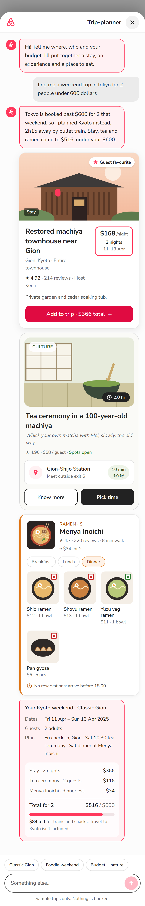 | 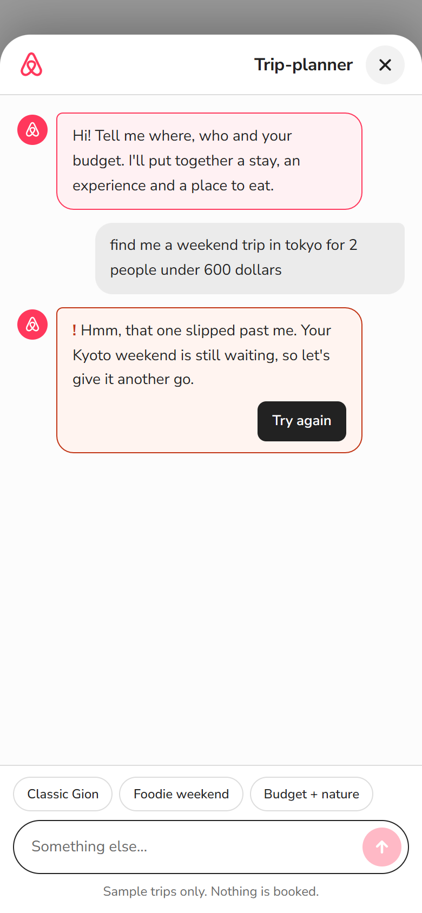 | 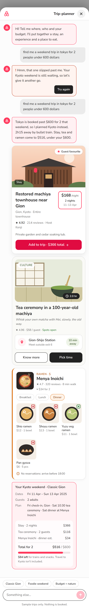 |
| **Laptop** (1440px) | 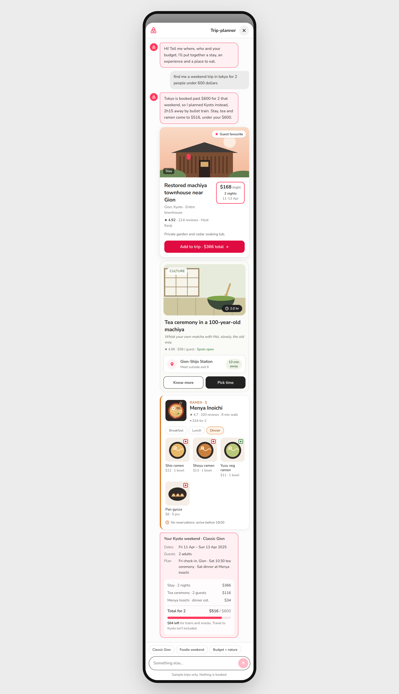 | 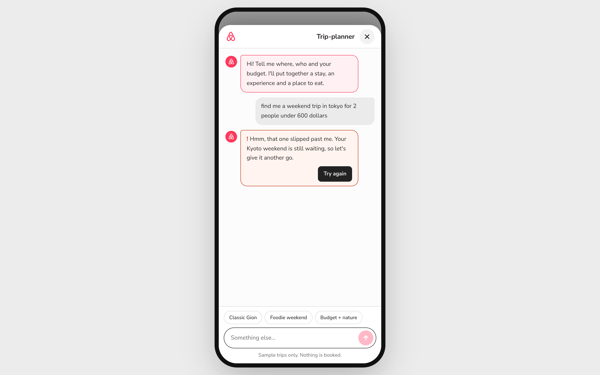 | 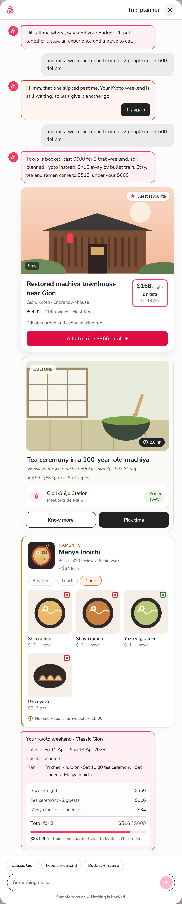 |

## Message for the team

| Item | Detail |
|---|---|
| Where to post | #search-trip-planner on Slack |
| Who it is for | Hannah Brooks, Tomás Herrera, Priya Raman, Daniel Okafor |
| Dry run | Thursday 13 March 2025 |
| First moderated guest sessions | 1 April 2025 |

> Hi Hannah, Tomás, Priya and Daniel, the Trip-planner chat prototype is ready for Thursday's dry run (13 March). Link: https://airbnb-trip-planner-dusky.vercel.app. No login or install; trips are sample data and nothing is booked.
>
> **Happy path:** send the pre-filled request, "find me a weekend trip in tokyo for 2 people under 600 dollars". You'll see thinking dots, skeletons, then three cards.
>
> **Error path:** add `?fail=once` to the link, send any request, then tap **Try again**.
>
> First guest sessions: 1 April.

## Stack

Next.js, React, TypeScript and Tailwind CSS, hosted on Vercel. There is no backend: the replies are typed mock data with simulated delays.
