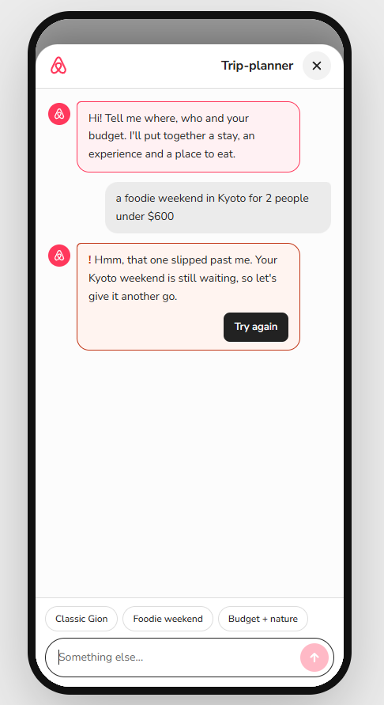

# Kyoto trip planner: three-card stage

**Live:** https://airbnb-trip-planner-dusky.vercel.app

A chat prototype inside the Airbnb mobile app. You ask for a weekend trip, and the chat replies with **three cards**: a stay, an experience and a meal. A trip summary under the cards checks the total against your budget.

This is a portfolio prototype. It uses Airbnb's name, logo and colours for demonstration only and isn't affiliated with Airbnb.

## Run it locally

Requires Node 20+. Run `npm install && npm run dev`, then open http://localhost:3000.

To see the error state, add `?fail=once` to the URL. See [Broken state](#broken-state).

## Card fields that use a filler line

The content comes from the *Kyoto Weekend Prototype Content Pack* workbook. Where the workbook has no value for a field, the card shows a filler line, marked `// filler` in `src/lib/mockReply.ts`.

| Card | Field with filler | What it shows |
|---|---|---|
| Stay | Popularity badge | "Guest favourite", "Rare find", "Great value" |
| Stay | Photo | A drawn illustration (the workbook has no cleared photos) |
| Experience | One-line description | e.g. "Whisk your own matcha with Mei, slowly, the old way." |
| Experience | **Know more** text | The longer description behind the button |
| Experience | Distance from the stay | e.g. "10 min away" |
| Experience | Photo | A drawn illustration |
| Food | Rating and review count | e.g. ★ 4.7 · 320 reviews |
| Food | Menu row (dishes, prices, portions, veg / non-veg) | e.g. Shio ramen $12 · 1 bowl |
| Food | Booking note (Sagano Yudofu-tei only) | "Walk-ins welcome at lunch" |
| Food | Photo | A drawn illustration |

Every other field (names, prices, dates, hosts, stay ratings, meeting points, walking times, availability) comes from the workbook.

## Three scenarios

The request decides which plan you get. The search is faked in `src/lib/planner.ts`: it reads the budget and theme words from your message. The chips above the message box send each sample request.

| Scenario | Try asking | Total for 2 |
|---|---|---|
| Classic Gion | "find me a weekend trip in tokyo for 2 people under 600 dollars" | $516 / $600 |
| Foodie weekend | "a foodie weekend in Kyoto for 2 people under $600" | $546 / $600 |
| Budget + nature | "Kyoto on a budget for 2, under $400, with some nature" | $279 / $400 (the sold-out walk is left out) |

Screenshots of each thread: [Classic Gion](docs/thread-1-classic-gion.png) · [Foodie weekend](docs/thread-2-foodie.png) · [Budget + nature](docs/thread-3-budget-nature.png).

## Broken state

**To fire it:** add `?fail=once` to the URL (https://airbnb-trip-planner-dusky.vercel.app/?fail=once) and send any trip request.

The first reply is a broken mock response the app can't turn into cards. The thread never goes blank: an error bubble appears with **Try again**, and tapping it brings the cards back. Only the first request fails.

### What happens

| Step | What you see |
|---|---|
| 1 | You send a request. The input locks and the thinking dots show. |
| 2 | Card-shaped skeletons show while the reply "loads". |
| 3 | The reply is checked, fails, and an error bubble replaces the skeletons: *"Hmm, that one slipped past me. Your Kyoto weekend is still waiting, so let's give it another go."* |
| 4 | **Try again** reruns the same request with real data: thinking dots, skeletons, then the three cards and the trip summary. |

### What is broken in the data

The broken reply is in `src/lib/brokenReply.ts`. It looks like a real reply but can't become the three cards:

| Card | Problem |
|---|---|
| Stay | No name, and the total is the text "three hundred", not a number |
| Experience | Labelled `activity`, which isn't one of the three card types |
| Food | Missing, so only two cards come back |

Every reply, real or broken, goes through `parseReply` in `src/lib/parseReply.ts` before it becomes cards. It needs three cards in the order stay → experience → food, each with its required fields. The broken reply fails that check, and the reason is logged to the browser console (`reply rejected: expected 3 cards, got 2`).

## Stack

Next.js, React, TypeScript and Tailwind CSS, hosted on Vercel. There is no backend: the replies are typed mock data with simulated delays.
