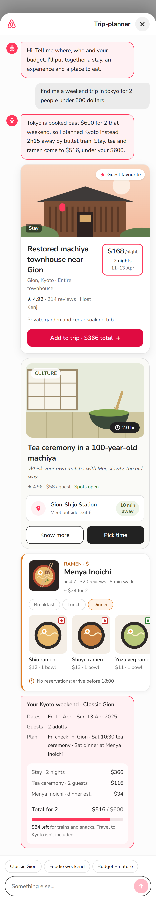
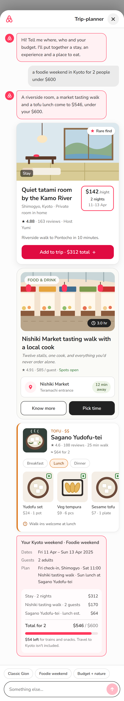
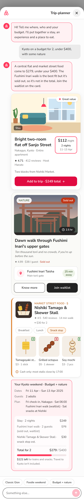

# Trip-planner chat: Kyoto three-card stage

**Live:** https://airbnb-trip-planner-dusky.vercel.app

This is a chat prototype inside the Airbnb mobile app. You ask for a weekend trip. The chat reads your request and replies with **three different cards** (a stay, an experience and a meal), plus a trip summary checked against your budget. The request decides which of **three trip scenarios** you get.

This is a portfolio prototype. It uses Airbnb's name, logo and colours for demonstration only and isn't affiliated with Airbnb.

## Three scenarios, one per search

| | 1 · Classic Gion | 2 · Foodie weekend | 3 · Budget + nature |
|---|---|---|---|
| **Try asking** | "find me a weekend trip in tokyo for 2 people under 600 dollars" | "a foodie weekend in Kyoto for 2 people under $600" | "Kyoto on a budget for 2, under $400, with some nature" |
| **Stay** | S1 · Machiya townhouse, Gion · $366 | S2 · Tatami room by the Kamo River · $312 | S3 · Two-room flat off Sanjo Street · $249 |
| **Experience** | E1 · Tea ceremony · $116 | E2 · Nishiki Market tasting walk · $170 | E3 · Dawn Fushimi Inari walk · $76, **sold out** |
| **Food** | F1 · Menya Inoichi ramen · $34 | F2 · Sagano Yudofu-tei tofu lunch · $64 | F3 · Nishiki tamago & skewer stall · $30 |
| **Total for 2** | $516 / $600 | $546 / $600 | $279 / $400 (the sold-out walk is left out) |

<p>



</p>

The chips above the message box (**Classic Gion**, **Foodie weekend**, **Budget + nature**) send each sample request in one tap.

## How the search picks a scenario

The logic is in `src/lib/planner.ts`. The search is faked, but it reads the request:

1. **Budget.** It takes the first dollar amount ("under 400 dollars", "$450", "500 usd"). If there isn't one, it uses the $600 reference budget.
2. **Theme.** It matches keywords:
   - culture, tea, temple or traditional → *Classic Gion*;
   - food, market, eat or tasting → *Foodie weekend*;
   - budget, cheap, nature, hike or shrine → *Budget + nature*.
3. **No theme.** It picks the first plan that fits the budget. At $600 that's Classic Gion; under $516 it's Budget + nature.
4. **Theme over budget.** If the requested theme costs more than the budget, it switches to a plan that fits and says so. For example, a foodie trip under $500 returns Budget + nature with a line explaining why.
5. **Tokyo.** If you ask for Tokyo, the intro explains that it planned Kyoto instead.
6. **Sold out.** A sold-out pick stays on its card with a **Join waitlist** button. It's left out of the total, and the summary marks it.

## What happens when you send

1. **The input locks.** The message box and send button are disabled while the agent works.
2. **Thinking.** Four dots stretch, squash, wave, and morph into the Airbnb logo, then the loop repeats.
3. **Skeletons.** Placeholders shaped like the three cards appear while the results load.
4. **The reply** has three parts:
   - a one-line summary;
   - the **Stay**, **Experience** and **Food** cards, stacked vertically;
   - the trip details: dates, guests, plan, and a cost breakdown against your budget.

## Three cards, three layouts

Each card is its own component, so the layouts stay different. Each scenario fills them with its own content and illustration.

| Card | Component | Layout |
|---|---|---|
| Stay | `src/components/cards/StayCard.tsx` | Full-width picture with a popularity badge, a boxed price (per night, 2 nights, 11–13 Apr) and an **Add to trip** button |
| Experience | `src/components/cards/ExperienceCard.tsx` | Inset picture with category and duration chips, a location sub-card ("10 min away"), and **Know more** / **Pick time**. When sold out, it shows **Join waitlist** instead |
| Food | `src/components/cards/FoodCard.tsx` | Square thumbnail beside the name, meal-time chips, and a sideways menu row with veg / non-veg markers |

## Where the content comes from

All content is in `src/lib/mockReply.ts`. It comes from the *Kyoto Weekend Prototype Content Pack*, where rows 1–3 of each sheet line up into the three scenarios. Row 4 isn't used for a scenario:
- S4 is a $612 ryokan, over budget on its own;
- E4 has no host;
- F4 is a $180 kaiseki dinner.

The workbook has no photos, so each card uses a drawn illustration. Fields it leaves out are filled with filler marked in the code: popularity label, distance, dishes, food rating, descriptions, and F2's booking note.

## Error states

- Add `?fail=once` to the URL. The first reply fails with a **Try again** bubble, and retrying brings the three cards back.
- Ask for two places at once, for example "japan and korea". You get a suggestion bubble with **Go with Kyoto**.

## Run locally

```bash
npm install
npm run dev     # http://localhost:3000
```

The stack is Next.js, React, TypeScript and Tailwind CSS, hosted on Vercel.

The project background, the earlier spec and the decision log are in the [project README](../../README.md).
