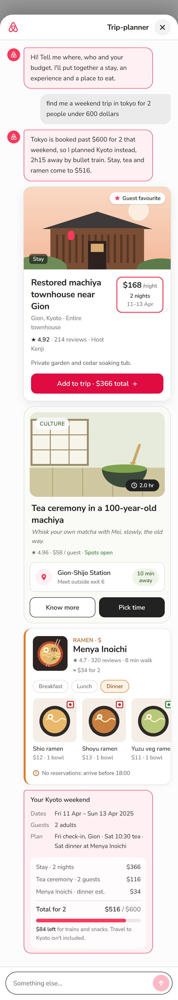

# Trip-planner chat: Kyoto three-card stage

**Live:** https://airbnb-trip-planner-dusky.vercel.app

This is a chat prototype inside the Airbnb mobile app. You ask for a weekend trip, and it replies with **three different cards** (a stay, an experience and a meal) plus a trip summary checked against your budget.

This is a portfolio prototype. It uses Airbnb's name, logo and colours for demonstration only and isn't affiliated with Airbnb.

## The thread

The sample request is: *"find me a weekend trip in tokyo for 2 people under 600 dollars"*.



## What happens when you send

1. **The input locks.** The message box and send button are disabled while the agent works.
2. **Thinking.** Four dots stretch, squash, wave, and morph into the Airbnb logo, then the loop repeats.
3. **Skeletons.** Placeholders shaped like the three cards appear while the results load.
4. **The reply** has three parts:
   - a one-line summary;
   - the **Stay**, **Experience** and **Food** cards, stacked vertically;
   - the trip details: dates, guests, plan, and a cost breakdown against the $600 budget.

## Three cards, three layouts

Each card is its own component, so the layouts stay different:

| Card | Component | Layout |
|---|---|---|
| Stay | `src/components/cards/StayCard.tsx` | Full-width photo with a popularity badge, a boxed price (per night, 2 nights, 11–13 Apr) and an **Add to trip** button |
| Experience | `src/components/cards/ExperienceCard.tsx` | Inset photo with category and duration chips, a location sub-card ("10 min away"), and **Know more** / **Pick time** |
| Food | `src/components/cards/FoodCard.tsx` | Square thumbnail beside the name, meal-time chips, and a sideways menu row with veg / non-veg markers |

## Where the content comes from

The reply in `src/lib/mockReply.ts` is a fake, hard-coded reply. It uses one row per sheet from the *Kyoto Weekend Prototype Content Pack*: Stay S1, Experience E1 and Food F1. Fields that the workbook leaves empty are filled with filler text. The prompt asks for Tokyo but the content is Kyoto, so the agent's summary explains the switch.

## Error states

- Add `?fail=once` to the URL. The first reply fails with a **Try again** bubble, and retrying brings the three cards back.
- Ask for two places at once, for example "japan and korea". You get a suggestion bubble with **Go with Kyoto**.

## Run locally

```bash
npm install
npm run dev     # http://localhost:3000
```

The stack is Next.js, React, TypeScript and Tailwind CSS, hosted on Vercel.

The project background, the earlier spec and the decision log are in the [project README](../../README.md).
